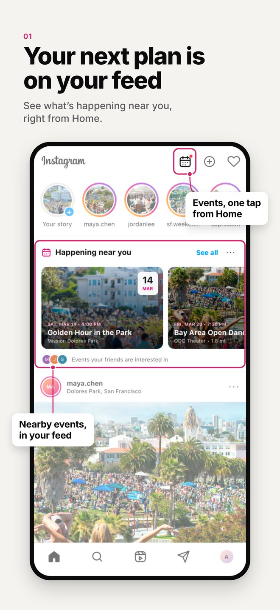
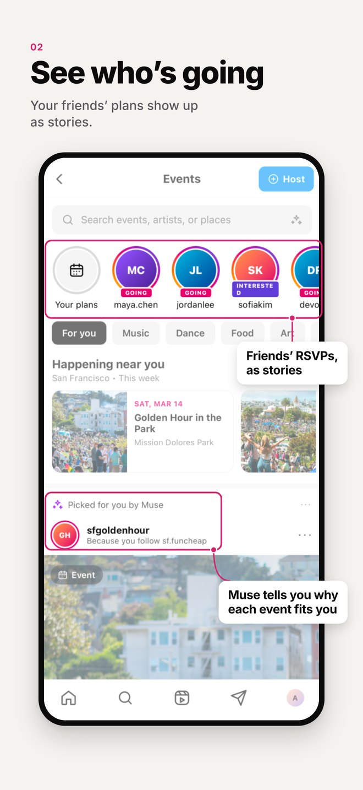
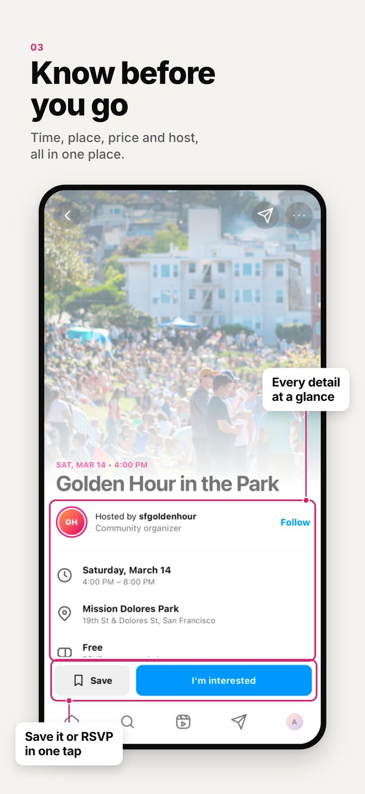
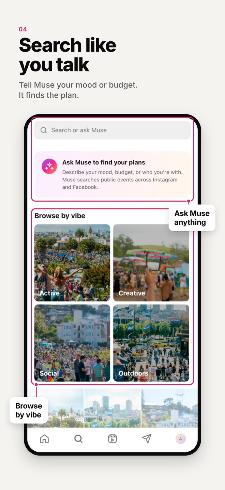
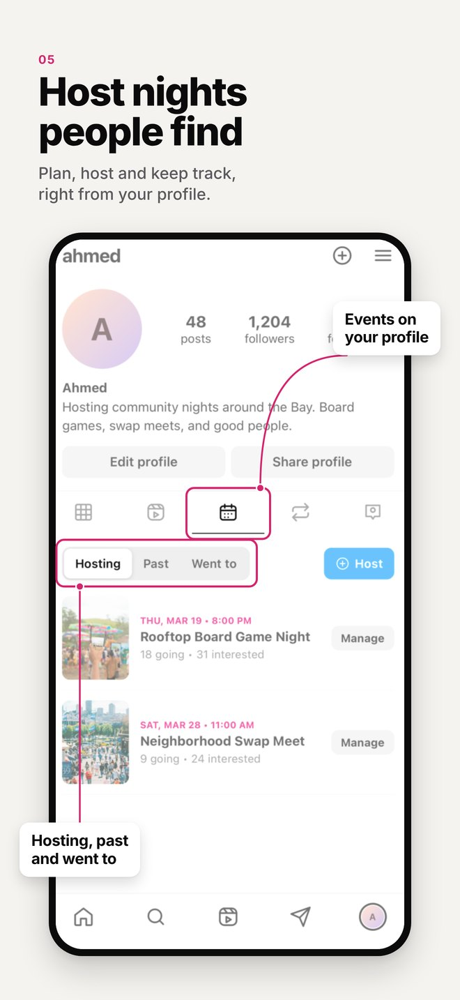

# Instagram Events


A hackathon demo that brings **Events** into Instagram. Find things to do near you, see which events your friends are going to, and host your own event without leaving the app.

Built at **HackTX 2026** for Meta's **"Bringing people closer together with AI"** track by Ricardo Pena and Tiffany Johnson.

> **A design concept, not an official Meta product.** This project is not affiliated with, endorsed by or sponsored by Meta or Instagram. It's a purely designed, front-end demo of what an Events feature could look like. It is not meant to be a working backend for Instagram Events: every event, person and comment is demo data, and Muse's responses are scripted.

<p>
  
  
  
  
  
</p>

**Read more:** [Product brief](docs/product-brief.md)

## Features

### Home feed
- An **events row** in the Home feed with events near you and events your friends are going to.
- **Sponsored event posts** show up in the feed with a **Get tickets** or **RSVP** button.
- Choose how many events appear on Home: all of them, fewer or none.

### Events tab
- **Search** events by name, place or vibe.
- **Friend plans** in a story-style row show what friends are going to. Tap one to watch it like a story and jump straight to the event.
- **Category chips** to filter by type of event.
- A **Happening near you** section, plus full event cards.
- One-tap **I'm interested** on every card.

### Event page
- A cover photo, the host, date and time, price, and interested and going counts.
- A **map** of the venue and its distance from you.
- **Who's going**, including friends.
- **Ask Muse:** ask questions about the event ("Can I go solo?", "Is parking easy?") and get an answer right away.
- **Comments** and **Experiences**, where attendees share photos and videos from the event.
- **Similar events** to keep exploring.
- Share, add to calendar or report the event, with anonymous reporting.

### Search
- Results for accounts, posts, reels and events in one place, with "See more" on each.
- A **Muse summary** of the matching events, with filters.

### Hosting an event
Tap **+** and choose **Event**, or tap **Host** on the Events tab.

1. **Basics:** add a cover photo, or have Muse generate one. Have Muse write the event name and description for you.
2. **Details:** pick the start and end time from a calendar and time picker, then set the location, free or paid tickets, links and audience (public, followers only or verified students). You can also require approval for RSVPs and turn on safety filters. Muse explains who the event will be recommended to.
3. **Review and share:** preview the event, choose where to share it (Instagram and Facebook Events), and build a **Promo Kit**.

### Promo Kit
- Muse makes a **Reel, a flyer, a story and two ads** for your event. You can regenerate any of them or upload your own photo or video.
- **Schedule each piece:** post it right away, a week before, three days before, a day before or the day of the event, or pick an exact date and time.
- Saved pieces are listed before you publish, with their scheduled time.

### Profile
- An **Events tab** on your profile with events you're **Hosting**, **Past** events and events you **Went to**.
- Make the "Went to" list private, or hide individual events from it.

## How Muse fits

Muse, Meta's AI, shows up wherever a person has to decide something: what to go to, whether it's worth going, and how to get the word out. Here's every place it's used in the app.

### Finding events

| Where | What Muse does | Function |
| --- | --- | --- |
| **Home**, "Happening near you" | Picks events near you and ones your friends are going to | `rankEvents` |
| **Events page**, "Picked for you by Muse" | Ranks event cards and shows why each one was picked ("Because you follow sf.funcheap") | `rankEvents`, `recommendationReason` |
| **Events page**, search bar | Searches events in plain language and sums up what it found | `searchEvents`, `summarizeSearch` |
| **Search tab**, "Search or ask Muse" | Understands requests like "free events this weekend" across events, accounts, posts and Reels, and sums up the event results | `searchEvents`, `searchPool`, `summarizeSearch` |

### Deciding to go

| Where | What Muse does | Function |
| --- | --- | --- |
| **Event page**, Muse summary | Sums up what to expect: cost, vibe and who it's for | `summarizeEvent` |
| **Event page**, Muse summary | Reads the comments and describes how people feel about the event | `summarizeComments` |
| **Event page**, Ask Muse | Answers questions like "Can I go solo?", "What should I wear?" or "Is parking easy?" | `answerQuestion` |
| **Event page**, Similar events | Suggests related events and says why each one fits | `similarEvents` |

### Hosting an event

| Where | What Muse does | Function |
| --- | --- | --- |
| **Create, step 1**, cover photo | Generates a cover image for the event | `coverLooks` |
| **Create, step 1**, "Create details with Muse" | Turns a few words into a title and description | `draftEventDetails` |
| **Create, step 1**, title and description | Suggests clearer wording, like a grammar checker, with Accept or Dismiss | `suggestTitle`, `suggestDescription` |
| **Create, step 2**, Muse audience match | Explains who the event will be recommended to, based on the audience setting | `audienceMatch` |
| **Promo Kit** | Makes a Reel (images and captions), a flyer, a Story and two ad variations from the event details | `promoImages`, `reelCaptions`, `adVariations` |

### How it's built

Every one of these goes through a single module, [`src/muse/`](src/muse/index.js). Screens import from `src/muse` and never from the implementation, so connecting real Muse means replacing one function at a time without touching the UI. Text features would be backed by Muse Spark, and image features (covers and Promo Kit visuals) by Muse Image.

Today the functions are scripted in [`src/muse/mock.js`](src/muse/mock.js) with simple rules over the demo data, so the demo works offline and never waits on the network. [`src/muse/index.js`](src/muse/index.js) documents the inputs and outputs each function should keep when it's swapped for a real call.

## Running it

You need Node.js and either the Expo Go app on your phone or a simulator.

```bash
npm install
npm start
```

Then press `i` for the iOS Simulator or `a` for an Android emulator, or scan the QR code with Expo Go. No accounts, keys or environment variables are needed.

## Project layout

- `App.js`: the app's entry point
- `src/ui/`: every screen and component
  - `data.js`: all of the demo data
  - `EventsApp.jsx`: switches between screens
  - `HomeScreen`, `EventsScreen`, `DetailScreen`, `SearchScreen`, `ProfileScreen`, `CreateScreen`, `PromoKit`: one file per screen
- `src/muse/`: the Muse layer (`index.js` is the interface, `mock.js` the scripted version)
- `docs/`: the product brief and screenshots

## Credits and license

This project started as a fork of [instagram-clone-app](https://github.com/hernanhawryluk/instagram-clone-app) by [Hernán Hawryluk](https://github.com/hernanhawryluk). His commit history is kept in this repository, and his work is used under the MIT License (see [LICENSE](./LICENSE)).

Instagram, Facebook and Muse are trademarks of Meta Platforms, Inc. This project is an independent student concept and is not affiliated with Meta.

MIT. Original work © 2023 Hernán Pablo Hawryluk.
